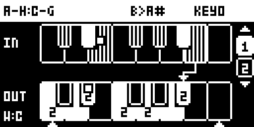
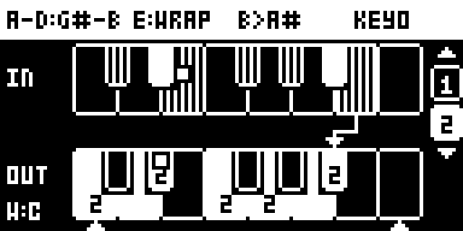

# KEY SCALE: a key track and a free scale remap for the Digitakt mk1

An [elekloader](https://elekloader.github.io/) mod for the **Digitakt mk1, OS 1.54**.

- **Key track:** T9's note trigs set a key. C5 means no change. Every other note transposes the
  tracks you pick by its distance from C5, and the key holds until T9 plays its next note. T9 itself
  is silent.
- **Scale remap:** a free 12-note table. Each input note C..B goes to any output note, so you can snap
  to a scale, swap notes or fold a mode into another. It isn't limited to preset scales.
- **Per track:** SCALE and TRANSPOSE can be turned on or off for each track. That covers the MIDI
  tracks T10–T16 and the audio tracks T1–T8 (on an audio track the note moves the sample's pitch).



*The scale editor with the notes snapped down onto G minor (G A B♭ C D E♭ F). IN is the input
keyboard. Remapped notes are striped, and the selected note (B) is inverted. OUT shows where the
inputs land, with a count on notes that more than one input lands on. The arrow is the selected
note's remap (B → A♯/B♭). The dot marks the last note played through the scale (E → E♭).*

> **Status: experimental.** Tested only in the [digiemu](https://github.com/irpina/digiemu) emulator, not on a unit yet.
> Keep the stock OS `.syx` and a way to reflash it. To get into the bootloader, hold FUNC at power-on,
> then press TRIG 4.

## Opening it

**FUNC + TRIG** opens stock **Quantize**, as usual. **Press FUNC + TRIG again** (with no other key in
between) and KEY SCALE opens over it. Pressing FUNC + TRIG once more goes back to Quantize, so the two
alternate. **NO** closes it, and any other key closes it and then does its usual job.

What opens depends on the active track:

| active track | screen |
|---|---|
| **T9** (the key track) | the **scale editor** |
| any other track | that track's **apply** screen: SCALE and TRANSPOSE on/off |

### The scale editor (on T9)

| control | does |
|---|---|
| knobs **A–H** | the output note of **C, C♯, D, D♯, E, F, F♯, G** (page 1) |
| **UP / DOWN** (or **TRIG**) | flip to page 2: knobs **A–D** for **G♯, A, A♯, B**; knob **E** moves the wrap note |
| trig keys | a keyboard in FUNC + TRK's layout (9–16 white keys, 2 3 5 6 7 black). **Hold a source note and press its new output** to set it. A tap only selects |
| **LEFT / RIGHT** | move the selection |
| **YES** | reset the selected note to itself |
| **FUNC + YES** | reset the whole table |

An output stays in its input's octave, in a window that runs from the **wrap note** up to the wrap
note an octave above, both ends included (C to C by default, marked under OUT and shown as `W:`).
The output can be the C an octave up (`C'`), so B → C' snaps B up to the next C instead of down.



*Page 2: knobs A–D for G♯..B, and E for the wrap note.*

### The apply screen (on any other track)

| control | does |
|---|---|
| knob **A** | SCALE on/off for this track |
| knob **B** | TRANSPOSE on/off for this track |

`LAST` shows the track's last fired note in and out. **TRN** and **SCL** light up when the transpose or
the scale moved it. By default SCALE and TRANSPOSE are on for T10–T16 and off for T1–T8.

## Using it

1. Pick the scale on T9's editor: for example the G minor snap above, or a full table of your own.
2. Turn SCALE and/or TRANSPOSE on for the tracks that should follow, MIDI (T10–T16) or audio
   (T1–T8, say a bass).
3. Put note trigs on **T9** for the harmonic progression: **C5 = the key as written**, D5 = up a
   whole tone, A4 = down a minor third, and so on. Each note holds until T9's next one.

T9 is meant to move slower than the rest. Set **T9's SCALE to 1/4 or 1/8** (per-track scale mode) so
that one T9 step lasts a bar or two, and/or give **T9 a long length** (up to 64 steps). Then a short
pattern on the other tracks plays through a long chord progression, and each track decides on its own
whether it is transposed, scaled, both or neither. For example, transposed but not scaled gives
parallel motion. Scaled but not transposed keeps a riff in key while a transposed bass moves.

For every note of a target track, the order is: `note + key` (if TRANSPOSE is on) → the scale
remap (if SCALE is on) → clamp to 0–127. On MIDI tracks each chord tone is remapped too.

### Details and limits

- **Sequenced trigs only.** Live playing and MIDI in are not transposed or scaled.
- The key goes back to 0 on stop. A chord on T9 uses its root.
- Mutes don't stop the key: a muted T9 still sets it.
- **Audio tracks and a slow T9:** audio tracks fire before T9 within a step. So that they don't lag one
  step behind a key change, they read T9's *next* stored step ahead of time. That assumes T9 runs at the
  same speed as the audio tracks, and ignores T9's trig conditions for that step. **With T9 at 1/4 or 1/8
  speed, audio targets can change key early**, up to one T9 step before it sounds. MIDI targets (T10–T16)
  follow T9 exactly at any speed.
- The table, the wrap note and the per-track switches are global (not per pattern). They are saved
  to the +Drive's eMMC **block 0x6004e** about a second after the last change, and loaded at boot. That
  block is empty on a fresh drive, but that the stock OS never writes it is assumed, not proven.
  The mod claims the block as `emmc:0x6004e`, so elekloader refuses a mod set where another mod
  claims the same block.

## Building

Needs [elekloader](https://github.com/elekloader/elekloader) and an m68k cross GCC (see elekloader's
docs). Requires **core ≥ 4.1** and **seq-events** (the DT1 one).

```bash
python3 -m elekloader.sdk.build path/to/keyscale --stock Digitakt_OS1.54.syx
# -> path/to/keyscale/out/keyscale-<ver>.elemod
```

Load the `.elemod` into the [elekloader builder](https://elekloader.github.io/elekloader/) together with
core and seq-events, or link locally:

```bash
python3 -m elekloader.patch --stock Digitakt_OS1.54.syx \
    --mod mods/core/out/core-4.4-os1.54.elemod \
    --mod mods/seq-events-dt1/out/seq-events-0.1-os1.54.elemod \
    --mod path/to/keyscale/out/keyscale-<ver>.elemod \
    --out keyscale.syx --version 1.5K
```

The README screenshots are digiemu `--check` snapshots of a build with `-DSHOT=1` (scale editor;
`-DSHOT=2` is the apply screen) added to `cflags`. Those builds open the overlay at boot with the G minor table and never save. Don't ship them.

No firmware is in this repo: not the stock OS, and not built `.syx` or `.elemod` files.

## License

GPL-2.0-or-later. See [LICENSE](LICENSE).
