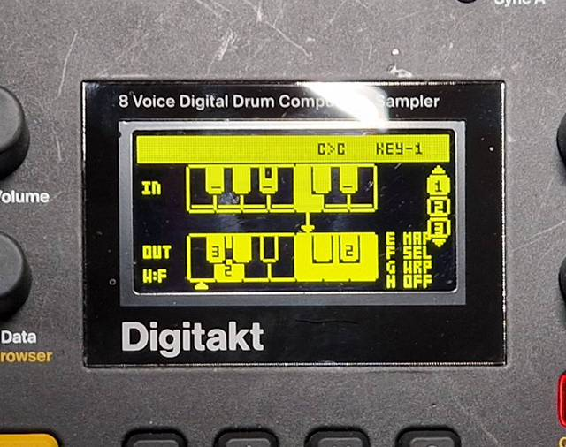
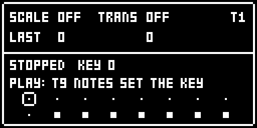

# T9-KeyScale: a key track and a free scale remap for the Digitakt mk1
An [elekloader](https://elekloader.github.io/) mod for the **Digitakt mk1, OS 1.54**.

Track 9 (first midi track) can be used to transpose other audio or midi tracks. A global freely adjustable scale is also applied (both can be turned on and off per track). If you set your T9 to play at 1/8, 1/4, 1/2 time scale, you can transpose your track or your outboard, while arbitrary scaling (not just presets or snaps) is applied to the result, to keep it harmonically fitting your material. A note every bar is enough to make progressions from short static rhythms. Can be used as an arp. Place trigs that will transpose notes on selected tracks (and outputted midi notes), with custom scales that can map any note to any note, so you can define where the notes should land, and generate time synced automated permutations by using a familiar Elektron sequencer interface, while keeping the harmonic progression musical. 

 **T9 is the key track**. Its notes drive the key, and this is fixed,
so plan your patterns around T9 not being a regular melodic track.

- **Key track:** T9's note trigs set a key. C5 means no change. Every other note transposes the
  tracks you pick by its distance from C5, and the key holds until T9 plays its next note. T9's notes
  still go out as usual: to keep T9 quiet, set its SRC channel to something nothing listens on.
  **Muting T9 holds the key**: while it's muted, its trigs don't change the key.
- **Scale remap:** a free 12-note table. Each input note C..B goes to any output note, so you can snap
  to a scale, swap notes or fold a mode into another. It isn't limited to preset scales.
- **Per track:** SCALE and TRANSPOSE can be turned on or off for each track. That covers the MIDI
  tracks T10–T16 and the audio tracks T1–T8 (on an audio track the note moves the sample's pitch).

A remapped note is underlined; the line is a pixel short on the side it moves away
from (left when it goes up, right when it goes down). OUT shows where the
inputs land, with a count on notes that more than one input lands on; a note nothing lands on
has an X. The selected note's output is inverted, and the arrow is the selected
note's remap i.e. (B → A♯/B♭). The dot marks the last note played through the scale.

## Opening it

**FUNC + TRIG** opens T9-KeyScale. **Press FUNC + TRIG again** and it closes and stock **Quantize**
opens. Pressing FUNC + TRIG once more (with no other key in between) goes back to T9-KeyScale, so the two
alternate. **NO** closes it, and any other key closes it and then does its usual job.

What opens depends on the active track:

| active track | screen |
|---|---|
| **T9** (the key track) | the **scale editor** |
| any other track | that track's **apply** screen: SCALE and TRANSPOSE on/off |

### The apply screen (other tracks)

The top row is the two switches, then the track: `SCALE [ON] TRANS [OFF]   T10`. They control whether a track is processed: turn knob **A** / **B**, or push it to flip. Flags are stored as T9 parameters. 

### The scale editor (on T9)

| control | does |
|---|---|
| knob **A** (page 1) | move the selection |
| knob **B** (page 1) | the output of the selected note (pick the note with **A**, the trig keys or LEFT/RIGHT) |
| knob **C** (page 1) | move the wrap note |
| knob **D** (page 1) | turn T9-KeyScale **off** for all tracks (a bypass). The keyboards and title bar disappear, leaving the knob hints (with **OFF** lit) and the page strip; turn **D** right (on any page) to switch it back on |
| knobs **E–H** (page 1) | the output note of the last four keys (**G♯, A, A♯, B** with wrap C). A knob's first turn only selects its note, so a stray touch doesn't edit; keep turning to change it |
| **DOWN** (or **TRIG**) / **UP** | the next / previous of three pages. Page 2: knobs **A–H** for the first eight keys (**C, C♯, D, D♯, E, F, F♯, G** with wrap C). Page 3: the slots (below) |
| knob **push** | **unlock** a note for editing. Every note starts locked at power-on (knob **B**, the value under the cursor, is never locked); editing a locked one (with its own knob or the trig keys) shows `PRESS TO UNLOCK` at the left of the title bar instead. Push the note's own knob (this also selects it), or push **B** for the selected note. Notes stay unlocked until power-off, or until T9-KeyScale is turned off with **D** (that locks them all again). A double tap still resets a locked note |
| trig keys | a keyboard in FUNC + TRK's layout (9–15 white keys, 2 3 5 6 7 black). **Hold a source note and press its new output** to set it. A tap only selects; a **double tap** resets that note to itself |
| **LEFT / RIGHT** | move the selection |
| **YES** | close the overlay, like NO (on page 3 it loads or saves the slot instead). FUNC + YES is left to stock's quick save |

An output stays near its input, in a window that runs from the **wrap note** up to the wrap note
an octave above. 

#### Memory Slots (page 3)

Four user slots, **U1–U4**, and two read-only presets: **CMAJ** and **GMIN**. In the presets, every note
outside the scale moves a semitone down onto it, with wrap C. A slot holds a table and its wrap
note. Each row shows the slot's scale as 12 cells, C..B: a block for a note some input lands on,
a dot for one nothing lands on. The wrap note is shown after the cells.

| control | does |
|---|---|
| **UP / DOWN** | pick a slot. UP on the top slot goes back to page 2 |
| **LEFT / RIGHT** | switch between **LOAD** and **SAVE** |
| **YES** | load the slot into the live table, or save the live table into it (user slots only). The slot becomes the active one, and the editor goes back to page 1 |

While T9-KeyScale is off, every track plays its notes untouched, whatever its SCALE and TRANSPOSE
switches say (the apply screens show `ALL OFF`). T9 still sets the key, so the key is right the
moment you switch it back on.

### Details and limits

- **Sequenced trigs only.** Live playing and MIDI in are not transposed or scaled.
- The key goes back to 0 on stop. A chord on T9 uses its root.
- **Muting T9 holds the key**  The current key stays in force and T9's trigs
  are ignored until you unmute it. The overlay's title bar shows `HLD` in place of `KEY` while it holds.
  Stopping still resets the key to 0, muted or not.
-

If you are interested in feeding your agent more details see
[devs.md](devs.md).
## License

GPL-2.0-or-later. See [LICENSE](LICENSE).
